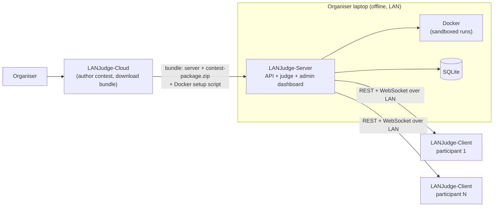
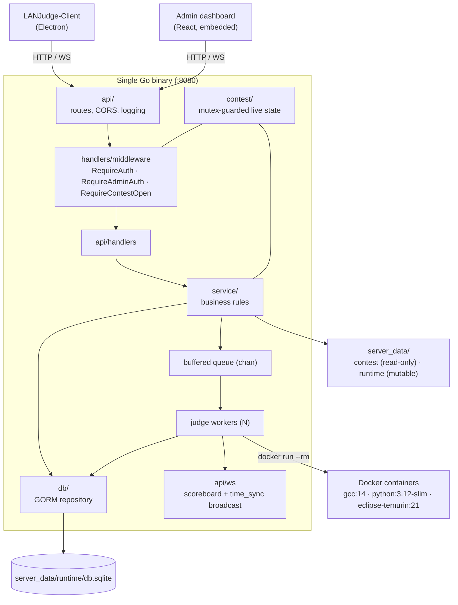

# LANJudge Server

**DISCLAIMER : **This is an AI generated README.md , Maybe one day when i am in the mood, i ll write it out myself because its currently very shitty. But hey, atleast the backend code is written totally by hand.

**The offline judge, API and admin dashboard that run a coding contest from a single organiser laptop.**

LANJudge Server is the on-site half of LANJudge: a LAN-based coding contest platform for universities, placement drives and lab exams. It ships as **one Go binary** with the admin dashboard embedded in it. Once it has a contest package, it needs **no internet** to register teams, serve problems, judge code in Docker sandboxes, keep a live scoreboard, and let the organiser control the contest.

It is not a Codeforces clone or an online judge, and it isn't a proctoring suite. It is a plug-and-play contest host for a room full of students on one network.

**You don't download or build this repo to run a contest.** Organisers get the ready-to-run server, already bundled with their contest, from the hosted LANJudge Cloud app:

**<http://65.0.183.82:8081>**

---

## The LANJudge project

LANJudge is three repositories that work in sequence:

| Repo | Role | When it runs |
|---|---|---|
| [LANJudge-Cloud](../LANJudge-Cloud) | Contest authoring. The organiser creates a contest, writes problems and test cases, and downloads a **bundle** for their platform containing this server, the contest package and a Docker setup script. Participants download the client app there too. | Before the contest, with internet |
| **LANJudge-Server** (this repo) | Reads the package and hosts the contest: auth, problems, sandboxed judging, scoreboard, admin dashboard. | During the contest, on the organiser's laptop, LAN only |
| [LANJudge-Client](../LANJudge-Client) | The participant's Electron app: a locked-down code editor with problem statements, submissions and a live scoreboard. | During the contest, on each participant's machine |



---

## Running a contest

All of this starts from the bundle you download on the Cloud app. The full walkthrough, including the setup scripts, is in the [LANJudge-Cloud README](../LANJudge-Cloud#setting-up-the-organisers-laptop). In short:

1. **Once, with internet:** run the bundle's setup script. It checks that [Docker Desktop](https://www.docker.com/products/docker-desktop/) is running and pulls the judge images (`gcc:14`, `python:3.12-slim`, `eclipse-temurin:21-jdk`).
2. **On contest day, offline:** start the server (`launch.command` on macOS, `campuscode-server.exe` on Windows). On first run it extracts `contest-package.zip`, creates the database, starts the judge workers, and opens the admin dashboard at `http://localhost:8080`.
3. Log in with the admin username and password you chose when you created the contest.
4. **Teams** tab: register each team and hand out its login code.
5. Participants install the client, enter the laptop's LAN IP address (the server listens on port `8080`), and sign in.
6. **Contest** tab: enter the duration and start the contest.

---

## What the server does

### Contest lifecycle
- Loads the contest from `contest-package.zip`, extracted once into `server_data/contest/` on first run. Restarts never overwrite it.
- The organiser drives a state machine from the dashboard: `pending → active ⇄ paused → ended`, with a reset back to `pending`.
- **Start** takes a duration (default 180 minutes) and sets the start time to now and the end time to now plus that duration.
- Participant problem and submission routes return `403` unless the contest is `active` and inside its time window.
- Contest state is saved to the database, so a restart resumes where it left off.

### Teams and authentication
- **Admin-registered teams.** The admin registers a team and gets a generated login code. There is no self-signup.
- **Device binding.** A team's first login binds it to that device (`X-Device-ID` header). Logging in from a different device is refused and creates a **device override request** for the admin to approve or reject. Approving it rebinds the team and ends its old sessions.
- **Sessions.** Bearer tokens that last 6 hours. A new login deactivates the team's previous sessions, so there is one live session per team.
- **Team status.** The admin can set a team to `enabled`, `disabled` or `disqualified`. Disqualified teams can't log in or submit and are hidden from the scoreboard.
- **Admin credentials** come from the contest package's `manifest.json`, not a user table.

### Judging
- **Languages:** C++17, Python 3.12 and Java 21.
- **Docker sandbox.** Every compile and run is a throwaway `docker run --rm` container.
  - Execution uses `--network=none`, `--cpus=0.5`, `--pids-limit=64`, and the problem's own memory limit.
  - Compilation is capped at 512 MB, 1 CPU and 30 seconds.
  - The time limit is per test case and comes from each problem's `meta.json`.
- **Queue and workers.** Submissions are saved, queued and judged by a pool of workers. The pool defaults to 8 workers and can be set with the `JUDGE_WORKERS` environment variable. The queue buffers 100 submissions.
- **Verdicts:** `AC`, `WA`, `TLE`, `RE`, `CE` and `IE` (internal error, for example a missing test case). Test cases run in order and judging stops at the first `WA`, `RE` or `CE`. Status moves `Queued → Running → Done`.
- **Rejudge.** The admin can requeue any submission.
- **"Run" scratchpad.** `POST /run` compiles and runs code against custom input with no database writes and no verdict. It's limited to 10 seconds and 256 MB, and only 3 can run at once. Extra requests get `429`.

### Scoreboard
- ICPC-style ranking: most problems solved, then lowest penalty, then earliest last accepted time.
- Penalty = minutes from contest start to the first `AC`, plus **20 minutes per wrong attempt** on that problem. Only `WA` verdicts count as wrong attempts. `CE`, `RE` and `TLE` are never penalised, and `CE` and `RE` don't update the scoreboard at all. Attempts after a problem is solved are ignored.
- **Live.** `GET /scoreboard` returns JSON over plain HTTP. If the client makes a WebSocket upgrade request, the connection stays open and receives a full snapshot on connect and a push after every judged submission.
- **Time sync.** The same WebSocket broadcasts `time_sync` messages (contest status, server time, end time) when the admin changes the contest and every 60 seconds. Clients use them to keep their timers consistent.

### Admin dashboard
An embedded React app served at `http://localhost:8080/`. The server opens it in the default browser on startup.

| Tab | What you can do |
|---|---|
| Submissions | Browse all submissions, read code and compile logs, rejudge |
| Teams | Register teams and see their login codes; set enabled, disabled or disqualified |
| Scoreboard | Live scoreboard over WebSocket |
| Contest | Start (with a duration), pause, resume, end or reset the contest |
| Overrides | Approve or reject device-change requests |

---

## Architecture



Request flow: `handler → service → db`. Handlers deal with HTTP only, services hold the rules, and the `db` package is the only code that touches GORM.

### Filesystem layout

```
<binary dir>/
├── campuscode-server(.exe)
├── contest-package.zip          # from LANJudge-Cloud; extracted on first run
└── server_data/
    ├── contest/                 # read-only during the contest
    │   ├── manifest.json        # contest name, duration, problem list, admin credentials
    │   └── problems/<id>/
    │       ├── meta.json        # time_limit_ms, memory_limit_mb
    │       ├── statement.md     # shown to participants
    │       └── tests/           # 1.in / 1.out, 2.in / 2.out, ...
    └── runtime/                 # mutable
        ├── db.sqlite
        ├── submissions/<id>/    # source code and compile.log (kept)
        └── workspaces/<id>/     # per-judging scratch dir (deleted afterwards)
```

The server changes into the binary's own directory at startup, so double-clicking it works the same on Windows, macOS and Linux.

### Key decisions

| Decision | Why | Trade-off |
|---|---|---|
| **SQLite (pure-Go driver, no CGO)** | Zero setup, one file, and the binary cross-compiles cleanly for every OS. | One writer. Fine for a single-room contest, not for multi-node scale. |
| **In-process buffered channel as the queue** | No broker to install on an offline laptop. | The queue is lost on crash (see [Known limitations](#known-limitations)). |
| **Docker per run** | Real isolation of untrusted code with no network. | Docker must be installed and running. Container startup adds latency per test case. |
| **Single binary with `go:embed` dashboard** | Organisers run one thing. | The dashboard must be built before the Go binary. |
| **WebSocket push for scoreboard and timer** | Live updates without every client polling. | In-memory connection registry. Single server only. |
| **Service layer between handlers and DB** | Rules (scoring, device binding, overrides) are testable and not tied to HTTP. | A little more indirection. |

---

## API

All routes are on port `8080`. Authenticated routes need `Authorization: Bearer <session_token>`.

**Participant**

| Method | Route | Notes |
|---|---|---|
| `POST` | `/login` | Body: `name`, `login_code`. Requires an `X-Device-ID` header. Returns `session_token`. |
| `GET` | `/contest` | Current contest state and times |
| `GET` | `/problems` | Problem list. Contest must be open. |
| `GET` | `/problems/{id}` | Statement (markdown), time and memory limits. Contest must be open. |
| `POST` | `/submit` | Body: `problem_id`, `language` (`cpp`, `python` or `java`), `code`. The team comes from the session. Returns `submission_id` with status `Queued`. Contest must be open. |
| `GET` | `/submission/{id}` | A team's own submission with its code and verdict |
| `GET` | `/submissions/me` | Own submissions, optional `?problem_id=` |
| `POST` | `/run` | Ad-hoc run: `language`, `code`, `input`. Contest must be open. |
| `GET` | `/scoreboard` | JSON, or a live WebSocket feed if upgraded |
| `GET` | `/health` | Liveness probe |

**Admin** (token from `POST /admin/login` with `user_name` and `login_code`; the WebSocket handshake can pass `?token=`)

| Method | Route | Notes |
|---|---|---|
| `POST` | `/register` | Create a team and receive its login code |
| `GET` | `/admin/teams` | List teams |
| `PATCH` | `/admin/teams/{id}` | `status`: `enabled`, `disabled` or `disqualified` |
| `GET` | `/admin/submissions`, `/admin/submissions/{id}` | List submissions, or get one with its code and compile log |
| `POST` | `/admin/submissions/{id}/rejudge` | Requeue a submission |
| `GET` | `/admin/overrides` | Pending and past device-change requests |
| `POST` | `/admin/overrides/{id}` | Body: `action` is `approve` or `reject` |
| `GET` / `PATCH` | `/admin/contest` | Read or change status, `start_time`, `end_time` |
| `GET` | `/admin/scoreboard` | Same as `/scoreboard` |

---

## For maintainers

The bundles on the Cloud app contain binaries built from this repo. To build one, build the dashboard first (it is embedded at compile time), then the server:

```bash
cd Frontend && npm install && npm run build   # output goes to Backend/api/web/dist
cd ../Backend && go build -o campuscode-server .
```

This needs Go 1.25+ and Node.js, and it cross-compiles without extra toolchains because there's no CGO.

[Backend/testing/](Backend/testing/) has scripts to generate a fixture contest and replay a realistic multi-team contest with AC, WA, CE and RE cases. See [README_TESTING.md](Backend/testing/README_TESTING.md) and [README_CURL_SEQUENCE.md](Backend/testing/README_CURL_SEQUENCE.md). [Backend/judge/README.md](Backend/judge/README.md) holds the original design notes. It describes a wider plan than what's built, so treat the code as the source of truth.

```
Backend/
├── main.go, startup.go      # wiring, package extraction, dashboard launcher
├── api/                     # routes, CORS, embedded dashboard, WebSocket hub
│   ├── handlers/            # HTTP handlers and auth/contest-gate middleware
│   └── ws/                  # scoreboard and time_sync broadcast
├── service/                 # business rules (auth, teams, submissions, overrides, contest, run)
├── judge/                   # queue, workers, Docker execution, problem/manifest loading
├── db/                      # persistence (GORM repository)
├── models/                  # entities, enums, DTOs, scoring rule
├── contest/                 # mutex-guarded live contest state
├── utils/                   # output normalisation, token generation, helpers
└── testing/                 # fixtures and replay scripts
Frontend/                    # admin dashboard (React + Vite), builds into Backend/api/web/dist
```

---

## Known limitations

- **No proctoring or monitoring yet.** Screenshots, focus-switch logging, idle detection and LAN auto-discovery or join codes are not implemented. Participants enter the server's IP address by hand, and the client app handles kiosk lockdown.
- **The contest name and duration from the package aren't applied.** The contest starts as `pending` with a default title. The duration comes from what the organiser enters when pressing Start.
- **Judging needs Docker on the host.** If Docker isn't running, compiles fail as `CE` and runs as `RE`, so a missing Docker looks like a participant error. Run the setup script and keep Docker Desktop open.
- **The queue lives in memory.** Submissions that are queued or running when the server crashes stay in their last status. Use the admin rejudge to recover them.
- **Rejudge doesn't recompute scoring.** It re-runs the verdict, but scoreboard stats are only updated on the first judging.
- **A time limit exceeded on one test case doesn't fail the submission.** The judge records the `TLE` for that test, carries on to the next test, and returns `AC` if the rest pass. A solution that is too slow on some tests can therefore be accepted. This is a known bug in the judge loop.
- **Compilation isn't network-isolated** (only execution is).
- **Three languages only:** C++, Python and Java.
- **Security suits a trusted LAN.** CORS is `*`, there is no TLS, and admin credentials are in plain text in the package's `manifest.json`. `/scoreboard` is public to anyone on the network. Don't expose the server to the internet.
- **Port `8080` is fixed**, and there is no logout endpoint (sessions expire after 6 hours).
- **The login response has no `team_id`.** It returns only `session_token`, so a client that wants to know its own team ID has to get it another way.

## License

[MIT](LICENSE) © 2026 Vivek Pandey
